


  <a href="https://www.linkedin.com/in/ryan-henrique-de-aguiar-dos-santos-282258236">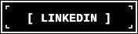</a>
  <a href="mailto:ryanaguiar871@gmail.com">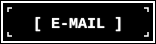</a>
  

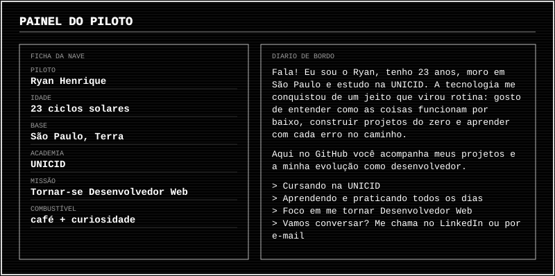

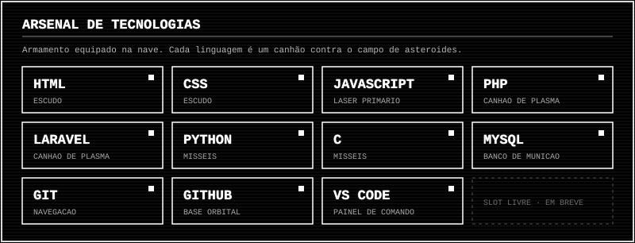

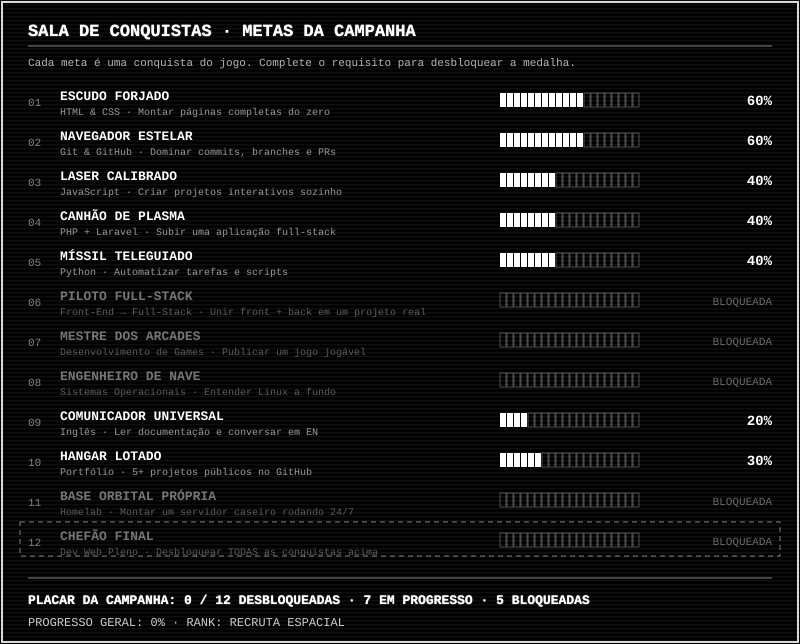

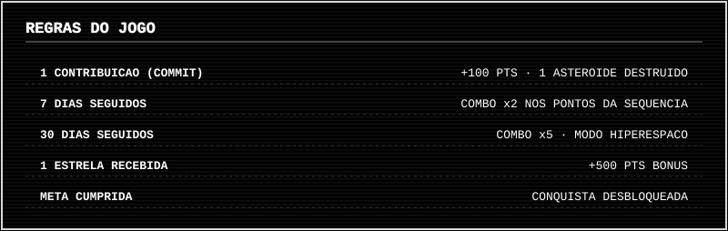


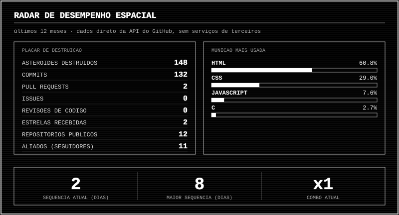

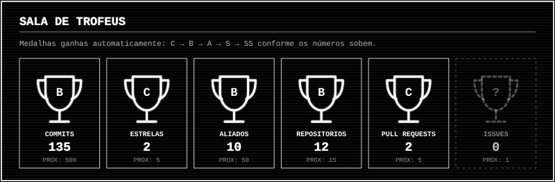

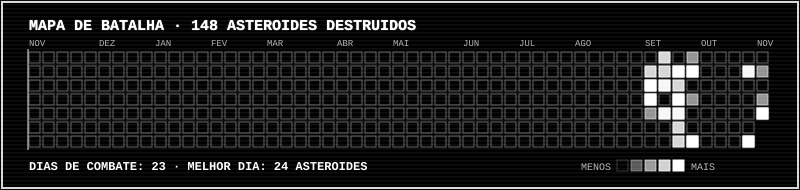

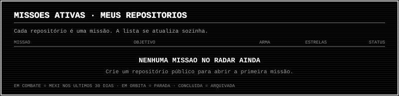

<!-- MISSOES:START -->
**Entrar em combate:** [CellGO](https://github.com/RyanHenrique20/CellGO) · [Santo-Taquito](https://github.com/RyanHenrique20/Santo-Taquito) · [exercicio-de-distribuicao-de-notas](https://github.com/RyanHenrique20/exercicio-de-distribuicao-de-notas) · [Cardapio](https://github.com/RyanHenrique20/Cardapio) · [Serenatto](https://github.com/RyanHenrique20/Serenatto) · [sortear-amigo-secreto](https://github.com/RyanHenrique20/sortear-amigo-secreto) · [compra-de-ingressos](https://github.com/RyanHenrique20/compra-de-ingressos) · [carrinho-de-compras](https://github.com/RyanHenrique20/carrinho-de-compras)
<!-- MISSOES:END -->


