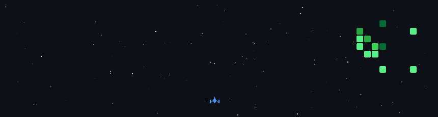

<div align="center">


<a href="https://github.com/RyanHenrique20">
  
</a>

<br/>

<a href="https://www.linkedin.com/in/ryan-henrique-de-aguiar-dos-santos-282258236">
  
</a>
<a href="mailto:ryanaguiar871@gmail.com">
  
</a>


<br/><br/>


</div>

<p align="center">🪨 · · · ☄️ · · · · 🛸 · · · · · 💥 · · · · 🚀 · · · ☄️ · · · 🪨</p>

## 🛸 Painel do Piloto

```yaml
piloto:      Ryan Henrique
idade:       23 ciclos solares
base:        São Paulo, Terra 🌎
academia:    UNICID 🎓
missão:      Tornar-se Desenvolvedor Web
combustível: café + curiosidade ☕
```

Fala! Eu sou o **Ryan**, tenho **23 anos**, moro em **São Paulo** e estudo na **UNICID**. A tecnologia me conquistou de um jeito que virou rotina: gosto de entender como as coisas funcionam por baixo, construir projetos do zero e aprender com cada erro no caminho.

Aqui no GitHub você acompanha meus projetos e a minha evolução como desenvolvedor.

- 🎓 Cursando na **UNICID**
- 🌱 Aprendendo e praticando todos os dias
- 🎯 Foco em me tornar **Desenvolvedor Web**
- 📫 Vamos conversar? Me chama no LinkedIn ou por e-mail

<p align="center">🪨 · · · ☄️ · · · · 🛸 · · · · · 💥 · · · · 🚀 · · · ☄️ · · · 🪨</p>

## 🔫 Arsenal de Tecnologias

> *Armamento equipado na nave. Cada linguagem é um canhão contra o campo de asteroides.*

<p align="center">
  
</p>

<p align="center">
  
  
  
  
  
</p>

<p align="center">🪨 · · · ☄️ · · · · 🛸 · · · · · 💥 · · · · 🚀 · · · ☄️ · · · 🪨</p>

## 🏆 Sala de Conquistas · Metas da Campanha

> *Cada meta é uma conquista do jogo. Complete o requisito para desbloquear a medalha.*

<div align="center">

| 🎖️ Conquista | 🎯 Meta | 📋 Requisito para desbloquear | 📊 Status |
|:--|:--|:--|:--:|
| 🛡️ **Escudo Forjado** | HTML & CSS | Montar páginas completas do zero | 🏆 **DESBLOQUEADA** |
| 🧭 **Navegador Estelar** | Git & GitHub | Dominar commits, branches e PRs | 🏆 **DESBLOQUEADA** |
| ⚡ **Laser Calibrado** | JavaScript | Criar projetos interativos sozinho | 🔓 Em progresso `70%` |
| 🔮 **Canhão de Plasma** | PHP + Laravel | Subir uma aplicação full-stack | 🔓 Em progresso `60%` |
| 🚀 **Míssil Teleguiado** | Python | Automatizar tarefas e scripts | 🔓 Em progresso `40%` |
| 🌐 **Piloto Full-Stack** | Front-End → Full-Stack | Unir front + back em um projeto real | 🔒 Bloqueada |
| 🎮 **Mestre dos Arcades** | Desenvolvimento de Games | Publicar um jogo jogável | 🔒 Bloqueada |
| 💻 **Engenheiro de Nave** | Sistemas Operacionais | Entender Linux a fundo | 🔒 Bloqueada |
| 📡 **Comunicador Universal** | Inglês | Ler documentação e conversar em EN | 🔓 Em progresso `50%` |
| 🗃️ **Hangar Lotado** | Portfólio | 5+ projetos públicos no GitHub | 🔓 Em progresso `30%` |
| 🛰️ **Base Orbital Própria** | Homelab | Montar um servidor caseiro rodando 24/7 | 🔒 Bloqueada |
| 👑 **CHEFÃO FINAL** | Dev Web Pleno | Desbloquear TODAS as conquistas acima | 🔒 Bloqueada |

</div>

<div align="center">

**Placar da Campanha:** `2 / 12 conquistas desbloqueadas` · `5 em progresso` · `5 bloqueadas`


</div>

### 🧭 Progresso das Fases

```diff
+ FASE 1 · HTML & CSS ............ [██████████] 🏆 CONQUISTA: Escudo Forjado
+ FASE 2 · Git & GitHub .......... [██████████] 🏆 CONQUISTA: Navegador Estelar
+ FASE 3 · JavaScript ............ [███████░░░] 🔓 Laser Calibrado · 70%
+ FASE 4 · PHP + Laravel ......... [██████░░░░] 🔓 Canhão de Plasma · 60%
! FASE 5 · Python ................ [████░░░░░░] 🔓 Míssil Teleguiado · 40%
- FASE 6 · CHEFÃO: Dev Web Pleno . [░░░░░░░░░░] 🔒 Requer todas as conquistas
```

<p align="center">🪨 · · · ☄️ · · · · 🛸 · · · · · 💥 · · · · 🚀 · · · ☄️ · · · 🪨</p>

## 🕹️ ARCADE · Asteroid Defense

<div align="center">
  
</div>

### 🚀 Fase Atual: Meus Commits Viraram Inimigos

> *Cada quadradinho do meu gráfico de contribuições é um asteroide. A nave atira e destrói um por um — quanto mais eu programo, maior a horda.*

<div align="center">
  
</div>

<div align="center">

| 🎯 Placar | 📌 Regra |
|:--:|:--|
| ☄️ 1 commit | **+100 pts** · 1 asteroide destruído |
| 🔥 7 dias seguidos | **Combo x2** |
| ⚡ 30 dias seguidos | **Combo x5 · Modo Hiperespaço** |
| ⭐ 1 estrela recebida | **+500 pts bônus** |
| 🏆 Meta cumprida | **Conquista desbloqueada** |

</div>

## 👾 Mission Status · Asteroid Defense System

<div align="center">

| 🎮 Regra do Jogo | 💥 Efeito |
|:--|:--|
| ☄️ **1 commit** | **1 asteroide destruído** |
| 🔥 **Streak de commits** | **Combo / Multiplicador de pontos** |
| 🏆 **Troféus** | **Conquistas desbloqueadas** |
| ⭐ **Estrelas nos repositórios** | **Bônus de pontuação** |

</div>

### 📡 Radar de Desempenho Espacial

<div align="center">
  
  
</div>

### 🔥 Combo Multiplicador

<div align="center">
  
</div>

### 🏆 Conquistas Desbloqueadas

<div align="center">
  
</div>

### 🌌 Mapa de Batalha

<div align="center">
  
</div>

<p align="center">🪨 · · · ☄️ · · · · 🛸 · · · · · 💥 · · · · 🚀 · · · ☄️ · · · 🪨</p>

<div align="center">


</div>
